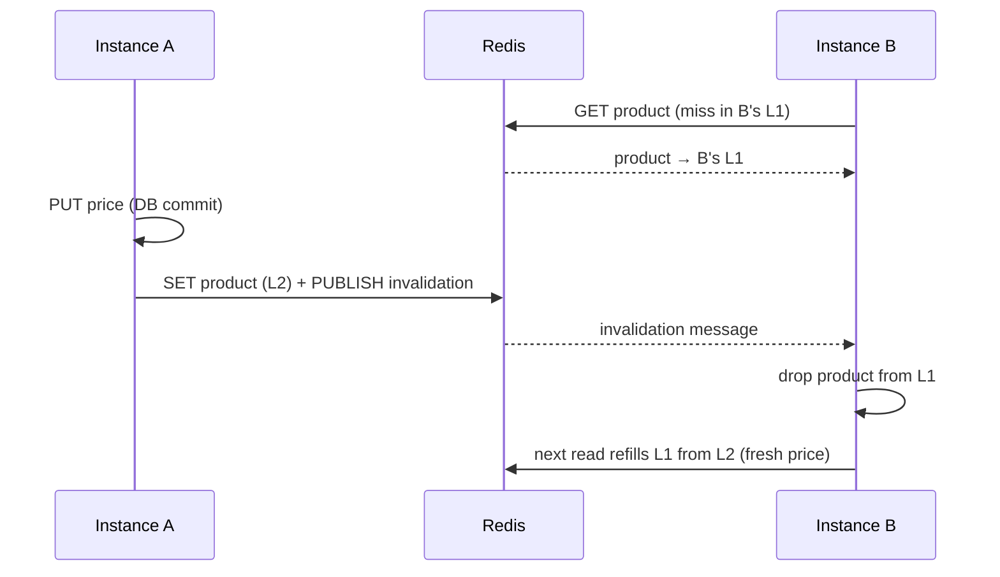

# Redis Caching Strategies

[](https://github.com/alef2509/redis-caching-strategies/actions/workflows/ci.yml)


A product catalog API where every use case gets the caching strategy that fits it,
each one implemented, measured and tested against real Redis and PostgreSQL.
"Add `@Cacheable`" is where caching starts; this project covers the problems that
show up afterwards: stale copies across instances, stampedes on hot keys, writes
racing with caches, and hot counters.

| Use case | Strategy | Problem it solves |
|---|---|---|
| `GET /products/{id}` | **Two-level cache** (Caffeine L1 + Redis L2) with **Pub/Sub invalidation** | Network hop on every read, stale local copies on other instances |
| `GET /products?category=` | **Cache-aside + stampede protection** (XFetch early refresh, distributed single flight, TTL jitter) | Hot key expiring under load and flattening the database |
| `PUT /products/{id}/price` | **Write-through** after commit + listing eviction | Price changes visible immediately, never a rolled-back value |
| `POST /products/{id}/views` | **Write-behind** with atomic batch cut and exactly-once flush | Thousands of increments per second on the same row |
| every `/api/**` call | **Token bucket rate limiter** in an atomic Lua script | Bursty clients, consistently across instances |

## Results

Measured with `docker compose` on a laptop, through HTTP. The database read is slowed
down by a simulated 50 ms (standing in for a heavy query or a remote database), so the
effect of each layer is visible:

| Request (median, warm JVM) | Latency |
|---|---:|
| Product, cache miss (database) | 63 ms |
| Product, cache hit | **5.7 ms** |
| Category listing of 100 products, cache hit | **9.0 ms** |

<sub>15-30 sequential requests per row, through HTTP on localhost. The point is the ratio, not the absolute numbers.</sub>

| Scenario | Database queries |
|---|---|
| 50 concurrent reads of an uncached product (one instance) | **1** |
| 100 concurrent reads of an uncached category listing | **1** |
| 200 view increments | 0 until the flush, then **1 batch** |

## How each strategy works

### Two-level cache ([ADR 1](docs/adr/0001-two-level-cache.md))



`TwoLevelCache` implements Spring's `Cache`, so the service code is just
`@Cacheable(cacheNames = "products", key = "#id", sync = true)`.

### Stampede protection ([ADR 2](docs/adr/0002-stampede-protection.md))

- **XFetch**: a read refreshes early when `now − computeTime · β · ln(rand) ≥ expiry`. Hot keys
  are refreshed by one request shortly before they expire, not by all of them after.
- **Single flight**: refreshing requires `SET lock NX PX`; the others serve the current value.
  The lock is released by a compare-and-delete Lua script.
- **Jitter**: TTL ±10 %, so keys cached together do not expire together.

### Write-through and write-behind ([ADR 3](docs/adr/0003-write-strategies.md))

- Prices: DB first, cache **after commit** (`TransactionSynchronization`), listing evicted.
- Views: `HINCRBY` in Redis; every 5 s a Lua script atomically renames the pending hash to a
  batch, the batch is applied in one transaction together with its id, then deleted. A crash
  between commit and delete cannot double count.

### Rate limiting ([ADR 4](docs/adr/0004-rate-limiting.md))

Token bucket per API key (or IP), entirely inside one Lua script using the **Redis server
clock**, so instances with skewed clocks still agree. Responses carry `RateLimit-Limit` and
`RateLimit-Remaining`; rejections are `429` with `Retry-After`.

```
$ for i in $(seq 25); do curl -s -o /dev/null -w "%{http_code} " -H "X-Api-Key: demo" localhost:8080/api/v1/products/$ID; done
200 200 200 200 200 200 200 200 200 200 200 200 200 200 200 200 200 200 200 200 200 200 429 429 200
```

## Running

```bash
docker compose up --build             # PostgreSQL, Redis, the API on :8080 (500 demo products)
# or: ./mvnw spring-boot:test-run     # same, with Testcontainers
```

| Endpoint | |
|---|---|
| `GET /api/v1/products/{id}` | two-level cache |
| `GET /api/v1/products?category=keyboards` | stampede-protected listing (`keyboards`, `mice`, `monitors`, `audio`, `video`) |
| `PUT /api/v1/products/{id}/price` `{"price": 99.90}` | write-through |
| `POST /api/v1/products/{id}/views` | write-behind counter (202) |
| `GET /api/v1/products/{id}/stats` | persisted vs pending views |
| `GET /actuator/metrics/catalog.db.queries` | database queries behind the caches |

## Testing

```bash
./mvnw verify    # Testcontainers: PostgreSQL 17 + Redis 8
```

| Test | Proves |
|---|---|
| `TwoLevelCacheIT` | one DB query per key, L1 serves even when the Redis key is gone, 50 concurrent misses → 1 load, **another instance's L1 is invalidated on write**, write-through leaves the cache fresh |
| `StampedeProtectionIT` | **100 concurrent cold reads → 1 query**, TTL jitter range, XFetch refreshes only near expiry, price change evicts the listing |
| `WriteBehindIT` | 200 concurrent views counted then flushed, views during a flush go to the next batch, **re-applied batch is not double counted** |
| `RateLimitIT` | burst then 429 with headers, independent clients, refill over time, **50 concurrent requests cannot overdraw the bucket** |

## Architecture decisions

1. [Two-level cache (Caffeine + Redis) with Pub/Sub invalidation](docs/adr/0001-two-level-cache.md)
2. [Cache stampede protection for hot keys](docs/adr/0002-stampede-protection.md)
3. [Write-through for prices, write-behind for view counters](docs/adr/0003-write-strategies.md)
4. [Distributed rate limiting with a token bucket in Lua](docs/adr/0004-rate-limiting.md)

## Tech stack

Java 21 · Spring Boot 3.5 · Spring Data Redis (Lettuce) · Spring Cache · Caffeine ·
Redis 8 (Lua scripts, Pub/Sub, hashes) · Spring Data JPA · PostgreSQL 17 · Flyway ·
Micrometer · JUnit 5 · Testcontainers · Awaitility · Docker · GitHub Actions

## License

[MIT](LICENSE)
